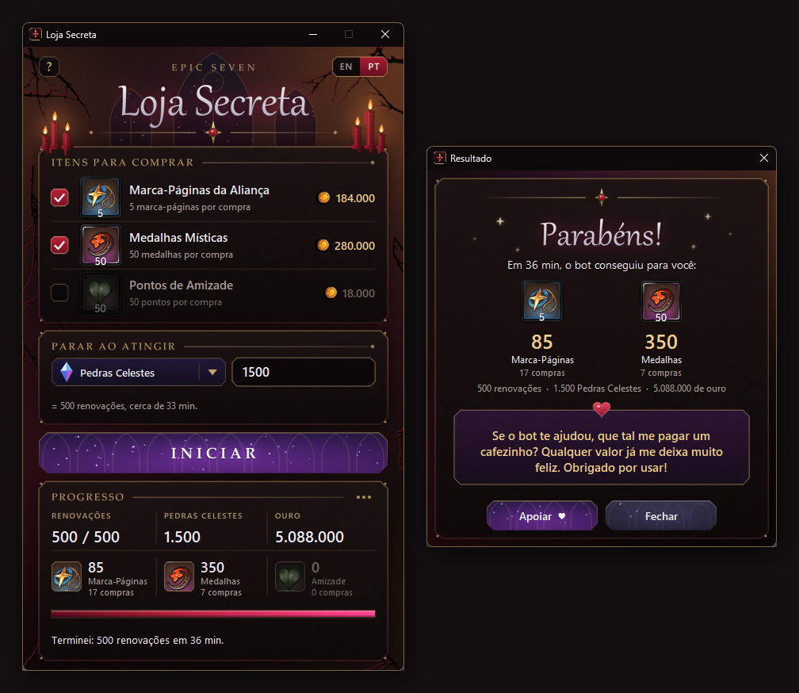

# Epic Seven Secret Shop Auto Refresh

Unofficial fan tool for the Secret Shop in Epic Seven (Windows PC client, Steam or STOVE). It refreshes the shop and buys the items you tick: Covenant Bookmarks, Mystic Medals and Friendship Points.

[Português abaixo](#português)

> **Use at your own risk.** This tool is not approved by Smilegate. Automating the game may break its rules, and your account could be penalized.

## Download

Get `SecretShop.zip` from [Releases](https://github.com/nixieda/secret-shop-helper/releases).

## How to use

1. Extract the whole zip to a folder.
2. Open Epic Seven on Steam or STOVE, in a window, and go to the Secret Shop.
3. Open `SecretShop.exe`, tick the items, choose when it should stop, type the value and press START.
4. Keep the game in front. If you move the mouse, it pauses until the mouse stays still. Press F8 or STOP to end it at any time.

**On STOVE:** STOVE runs the game as administrator, and Windows only lets a program see and click it if that program also runs as administrator. When you press START, the bot offers to reopen itself as administrator, and Windows asks for your permission.

The **?** at the top opens the support page, and the three dots next to PROGRESS show everything the bot has spent and bought so far.

## What it does on your PC

It looks at the game window, clicks with the mouse and resizes the window if needed. It does not read or change the game's files or memory, and it does not use the internet: the support buttons only open the link in your browser. It saves its settings, a log and, when it stops on an error, screenshots in its own folder. The all-time totals go to `%APPDATA%\SecretShop`, so they are kept when you download a new version.

## Known limits

- Windows 10 or 11 only. Emulators are not supported.
- Tested on one PC. It may behave differently on other setups.
- A game update that changes the shop's images can stop it from working until it is updated.

## Found a problem?

If it missed an item or stopped by mistake, please open an [issue](https://github.com/nixieda/secret-shop-helper/issues) and say what happened and which PC you use. Before attaching `historico.log` or a screenshot, check them: the log can show your Windows user name and a screenshot can show your account.

## Support the project

The bot is free. If it helped you, you can chip in on [Ko-fi](https://ko-fi.com/nixieda).

## License

The code is under the [MIT License](LICENSE). Epic Seven and the images taken from it belong to Smilegate and are not covered by that license.

---

# Português

Ferramenta não oficial, feita por fã, para a Loja Secreta do Epic Seven (cliente de PC no Windows, pela Steam ou pelo STOVE). Ela renova a loja e compra os itens que você marcar: Marca-Páginas, Medalhas Místicas e Pontos de Amizade.

> **Use por sua conta e risco.** Esta ferramenta não tem aprovação da Smilegate. Automatizar o jogo pode violar as regras, e sua conta pode ser punida.

## Baixar

Baixe o `SecretShop.zip` em [Releases](https://github.com/nixieda/secret-shop-helper/releases).

## Como usar

1. Extraia o zip inteiro para uma pasta.
2. Abra o Epic Seven pela Steam ou pelo STOVE, em janela, e entre na Loja Secreta.
3. Abra o `SecretShop.exe`, marque os itens, escolha quando ele deve parar, digite o valor e aperte START.
4. Deixe o jogo na frente. Se mexer no mouse, ele pausa até o mouse ficar parado. Aperte F8 ou STOP para parar a qualquer momento.

**No STOVE:** o STOVE abre o jogo como administrador, e o Windows só deixa um programa ver e clicar nele se esse programa também rodar como administrador. Quando você aperta START, o bot se oferece para reabrir como administrador, e o Windows pede sua permissão.

O **?** no topo abre a página de apoio, e os três pontinhos ao lado de PROGRESSO mostram tudo o que o bot já gastou e comprou.

## O que ele faz no seu PC

Ele olha a janela do jogo, clica com o mouse e ajusta o tamanho da janela se precisar. Não lê nem altera os arquivos ou a memória do jogo e não usa a internet: os botões de apoio só abrem o link no seu navegador. Guarda as configurações, um registro e, quando para por erro, capturas de tela na própria pasta. O histórico total fica em `%APPDATA%\SecretShop`, para continuar quando você baixar uma versão nova.

## Limites conhecidos

- Só Windows 10 ou 11. Emuladores não funcionam.
- Testado em um PC. Pode se comportar diferente em outras configurações.
- Uma atualização que mude as imagens da loja pode fazê-lo parar de funcionar até ser atualizado.

## Achou um problema?

Se ele deixou passar um item ou parou sem motivo, abra uma [issue](https://github.com/nixieda/secret-shop-helper/issues) contando o que aconteceu e qual PC você usa. Antes de anexar o `historico.log` ou uma captura, confira o conteúdo: o registro pode mostrar seu nome de usuário do Windows e a captura pode mostrar sua conta.

## Apoie o projeto

O bot é gratuito. Se ele te ajudou, você pode apoiar pelo [Ko-fi](https://ko-fi.com/nixieda) ou por Pix, com a chave aleatória `d8d05d06-fd35-47f7-9cec-91ed5a06b250`.

## Licença

O código está sob a [Licença MIT](LICENSE). O Epic Seven e as imagens tiradas dele pertencem à Smilegate e não fazem parte dessa licença.
